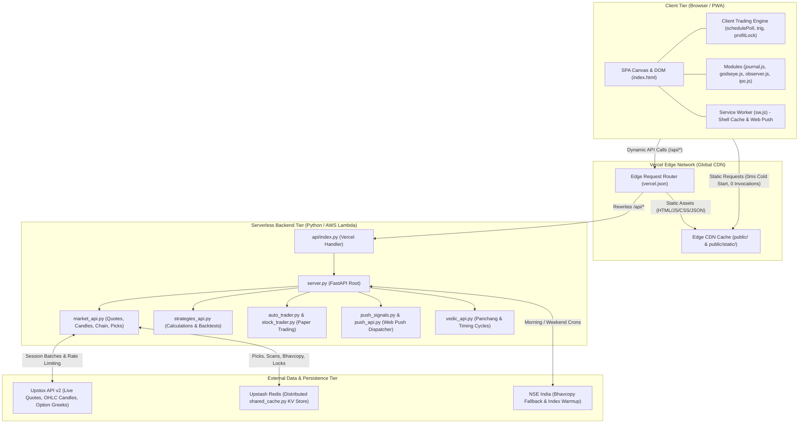

# Rajan Algo — Architecture & System Design Guide

> **System Overview**: High-performance, real-time algorithmic stock scanner, paper trading, and analytics platform for NSE/BSE equities and F&O instruments. Built with a Vanilla JS Single-Page Application (SPA) frontend, a Python FastAPI serverless backend, Upstox API v2 live feeds, Upstash Redis distributed caching, and deployed on the Vercel Edge Platform.

---

## 1. High-Level Architecture Diagram



---

## 2. Vercel Hosting & Infrastructure Model

### A. Separation of Edge CDN vs. Serverless Compute
The platform uses a split architecture to optimize performance and prevent exceeding Vercel Hobby tier invocation limits:

1. **Edge CDN Layer (`public/` and `public/static/`)**:
   * All static frontend files (HTML, JS, CSS, PNG icons, SVG icons, and precomputed JSON backtests/seeds) are served directly by Vercel’s global Edge network.
   * **Compute Cost**: 0 serverless function invocations.
   * **Latency**: < 30ms served from local Point of Presence (PoP) edge nodes (e.g., Mumbai, Delhi).
   * **Fast Origin Transfer**: Near 0 GB, because static bytes never originate from the serverless Python Lambda.

2. **Serverless Compute Layer (`api/index.py` ➔ `server.py`)**:
   * Invoked **only** when a dynamic endpoint is hit (e.g. `/api/m/quotes`, `/api/m/picks`, `/api/news`, `/api/cache-version`).
   * Runs in an ephemeral Linux micro-container (AWS Lambda) via Vercel's Python runtime.
   * Max execution duration: 30 seconds (`maxDuration: 30`).

### B. Routing and Header Strategy (`vercel.json`)
Vercel processes incoming requests in this exact order:
1. **Headers**: Applied to matched routes.
2. **Filesystem Check**: If the URL corresponds to a physical file inside `public/`, Vercel immediately serves it from the edge cache and **skips rewrites**.
3. **Rewrites**: If no physical file matches (e.g. `/api/m/quotes`), the rewrite rules redirect the request to `/api/index.py`.

```json
{
  "functions": {
    "api/index.py": { "maxDuration": 30 }
  },
  "headers": [
    {
      "source": "/static/(.*)",
      "headers": [
        { "key": "Cache-Control", "value": "public, max-age=86400, s-maxage=604800, stale-while-revalidate=86400" }
      ]
    },
    {
      "source": "/sw.js",
      "headers": [
        { "key": "Cache-Control", "value": "no-cache, no-store, must-revalidate" },
        { "key": "Service-Worker-Allowed", "value": "/" }
      ]
    },
    {
      "source": "/(index.html)?",
      "headers": [
        { "key": "Cache-Control", "value": "no-cache, must-revalidate" }
      ]
    }
  ],
  "rewrites": [
    { "source": "/(.*)", "destination": "/api/index" }
  ]
}
```

### C. Caching Rules & Invalidation Policy
* **Hashed Assets (`/static/*?v=...`)**: Long-lived edge cache (`s-maxage=604800` / 7 days). Because scripts and CSS carry `?v=` hashes, new builds automatically bust the browser cache.
* **Entrypoints (`index.html`, `sw.js`)**: Marked `no-cache, must-revalidate`. The browser checks for updates on every full visit.
* **Deploy-Time Invalidation**: Every `git push` automatically creates a new deployment on Vercel and clears stale edge caches.
* **API Edge-Caching**:
  * `/api/news`: `s-maxage=60, stale-while-revalidate=300` (news is identical for all users and updates every few minutes).
  * `/api/m/picks`: `s-maxage=30, stale-while-revalidate=60` on regular polls; completely uncached when `refresh=true`.
  * `/api/m/quotes`: **Uncached / Real-Time**. Kept live so stop-losses and trailing targets never operate on stale prices.

---

## 3. Frontend Architecture (Vanilla SPA & Canvas Engine)

### A. Core Design Philosophy
* **Zero External Frameworks**: No React, Vue, or Webpack bundle overhead. The app loads instantly even on poor mobile connections.
* **Direct DOM & Canvas Rendering**: The charting engine paints candles, volume, and overlays directly onto HTML5 `<canvas>` elements at 60 FPS.

### B. The Polling & Tick Loop (`schedulePoll`)
In `public/index.html`:
```javascript
function schedulePoll() {
  pollQuotes().finally(() => setTimeout(schedulePoll, 
    document.hidden ? 30000 : (MKT.err || MKT.stale) ? 20000 : MKT.open ? 5000 : 60000
  ));
}
```
* **Adaptive Polling Intervals**:
  * **5 seconds**: When market is open and tab is active.
  * **20 seconds**: If there is an Upstox connection hiccup or stale quote flag.
  * **30 seconds**: When the tab is hidden or minimized (saves user battery and network).
  * **60 seconds**: When the market is closed.

### C. Client-Side Trading & Trailing Stop Engine (`trig()`)
When `/api/m/quotes` returns latest prices, `trig(s, pv)` evaluates open orders and positions:
1. **Trailing Stop Loss (`p.tsl`)**:
   Tracks the peak favorable price (`p.peak`). If the price rises, the trailing stop ratchets higher. The stop never moves backward.
2. **Auto Profit Lock (`profitLock()`)**:
   * **₹1,500 Profit**: Stop moves to cost + estimated taxes/brokerage (risk-free trade).
   * **₹2,000+ Profit**: Stop locks in 50% of peak open gains.
3. **Limit Order Matcher**:
   Simulates exchange fills for open paper orders against live Bid/Ask prices.

### D. Progressive Web App (PWA) & Web Push (`public/sw.js`)
* **Shell Caching**: On install, caches the application shell (`/`, `/static/journal.js`, `/manifest.webmanifest`, icons) for offline resilience.
* **Network-First Policy**: Always tries network first. Only falls back to cache when offline.
* **VAPID Web Push**: Receives encrypted notifications even when the browser or screen is closed. Tapping the notification focuses the existing tab or opens the specific stock URL.

---

## 4. Backend Architecture (FastAPI & Services)

### A. Broker Connection: Upstox API v2
* Implemented in `upstox_service.py` and `nse_service.py`.
* **Token Management**: Checks Upstox bearer tokens and surfaces status via `/api/m/health`.
* **Quote Batching**: Consolidates symbols into batches (up to 500 symbols per request) to prevent exceeding Upstox rate limits (25 requests/sec).
* **Background Worker Queue (`_BG`)**: Dispatches heavy tasks to worker threads while keeping HTTP responses non-blocking.

### B. Distributed Cache: Upstash Redis (`shared_cache.py`)
Because Vercel serverless functions do not share local memory:
* `shared_cache.py` connects to **Upstash Redis** over HTTP REST.
* Stores:
  * Daily Bhavcopy cache (`bhav:*`)
  * Accumulated intraday cash picks (`picks:cash|YYYY-MM-DD`)
  * Distributed build locks (`shared_cache.lock("picks-build", 40)`) to avoid duplicate concurrent builds.

### C. Stock Scanner & Cash Seed Injection (`market_api.py`)
1. **Universe**: 500+ NSE F&O equities, main indices (NIFTY, BANKNIFTY, FINNIFTY, MIDCPNIFTY, SENSEX), and broad cash stocks.
2. **Cash Seed Fallback**:
   * `picks_cash_seed.json` contains pre-calculated momentum setups for 364+ cash stocks.
   * `_inject_cash_seed_if_needed(data)` verifies if cash picks exist. If not, it hydrates the payload instantly from the static seed so the user never sees a blank dashboard.

### D. Automated Paper Trader (`auto_trader.py`)
* Maintains virtual account balance, margins, position history, and daily realized PnL.
* Evaluates rule-based entries:
  * Supertrend 10/2 + 10/3 alignment
  * EMA 9/21 crossovers
  * Volume surges (> 1.5x 20-day average)
* Syncs state periodically to `shared_cache` and client `localStorage`.

---

## 5. End-to-End Data Flow Lifecycles

### Lifecycle 1: User Opens the App
```
Browser ➔ Requests "/"
  └── Vercel Edge CDN intercepts ➔ Returns public/index.html (<30ms, 0 Python calls)
Browser ➔ Requests "/static/journal.js?v=...", "/static/picks_cash_seed.json?v=..."
  └── Vercel Edge CDN intercepts ➔ Returns from Edge Cache (<20ms, 0 Python calls)
Browser ➔ Background check "/api/cache-version"
  └── Python Lambda executes ➔ Returns date-bucket-sha JSON (~200ms)
```

### Lifecycle 2: Live Market Polling
```
Browser ➔ GET /api/m/quotes?symbols=NIFTY,BANKNIFTY,RELIANCE...
  └── Vercel Edge passes to api/index.py (no cache header)
        └── server.py ➔ market_api.py
              └── upstox_service fetches full quotes
                    └── Returns quotes array to Browser
Browser ➔ trig(symbol, prevPrice)
  ├── Updates UI Candlestick & Tick Tape
  ├── Checks Trailing Stop Loss & Profit Lock
  └── Fires Audio / Toast Alert if levels hit
```

### Lifecycle 3: Deploy & Auto-Cache Clear
```
1. Developer runs git push origin rajan-web-session.
2. Vercel automatically deploys and purges all Edge CDN caches.
3. server.py generates a new VERCEL_GIT_COMMIT_SHA in /api/cache-version.
4. Client's checkCacheVersion() runs every 5 minutes:
     Detects new version hash ➔ Drops browser CacheStorage ➔ Reloads page.
5. All devices are seamlessly updated without manual user intervention.
```

---

## 6. Project Directory Map

```
rajanstocks/
├── public/                       # DIRECTLY SERVED BY VERCEL EDGE CDN (0 Python calls)
│   ├── index.html                # Main SPA Single-Page UI & Canvas Charting Engine
│   ├── sw.js                     # Service Worker (PWA Shell Cache & Web Push)
│   ├── manifest.webmanifest      # PWA App Manifest (icons, standalone display mode)
│   ├── favicon.svg / .ico        # Browser Favicons
│   ├── icon-192.png / 512.png    # Mobile App Icons
│   └── static/                   # Heavy Assets & Seed Data (Edge Cached)
│       ├── journal.js            # Trading Journal & Analytics UI Module
│       ├── godseye.js / .css     # God's Eye Heatmap & Sector Scanner
│       ├── observer.js           # Live Event Diagnostics & Token Health Logger
│       ├── ipo.js                # IPO Dashboard & Grey Market Premium Tracker
│       ├── picks_cash_seed.json  # 1.06 MB Precomputed Cash Stock Picks Seed
│       ├── accuracy_report.json  # Backtested Strategy Accuracy Dataset
│       └── *_backtest.json       # Historical Strategy Output Datasets
│
├── api/
│   └── index.py                  # Vercel Serverless Entry Point (exports FastAPI `app`)
│
├── server.py                     # FastAPI Root Application (Middlewares, Crons, Routes)
├── market_api.py                 # Core Quotes, Candles, Option Chain, & Picks API
├── upstox_service.py             # Upstox API v2 Client, Rate Limiter, & Session Manager
├── nse_service.py                # NSE India Client & Session Warmer
├── shared_cache.py               # Upstash Redis KV Distributed Caching Layer
├── auto_trader.py                # Automated Paper Trading Engine & Strategy Runner
├── stock_trader.py               # Order Execution, Book Management, & Margin Tracking
├── push_signals.py / push_api.py # Web Push Notification Dispatcher (VAPID)
├── indicators.py                 # Core Technical Indicators (Supertrend, EMA, RSI, MACD)
├── vedic_api.py / vedic_*.py     # Astrological Hora, Panchang, & Planetary Timing Cycles
├── backtest.py                   # Historical Strategy Backtesting Simulator
├── vercel.json                   # Vercel Configuration (Headers, Rewrites, Cron Jobs)
├── requirements.txt              # Python Serverless Dependencies
├── start.bat                     # Windows Local Development Startup Script
└── docs/                         # Project Documentation (Ignored by Vercel Builds)
    └── ARCHITECTURE.md           # This Architecture Document
```

---

## 7. Developer Cheat Sheet & Operations

* **Start Local Server**: Double-click `start.bat` or run:
  ```powershell
  python -m uvicorn server:app --host 127.0.0.1 --port 8000
  ```
* **Verify Vercel Deployment**: Push changes to branch `rajan-web-session`:
  ```powershell
  git add .
  git commit -m "feat: your change"
  git push origin rajan-web-session
  ```
* **Emergency Rollback**:
  ```powershell
  git revert <commit-hash>
  git push origin rajan-web-session
  ```
